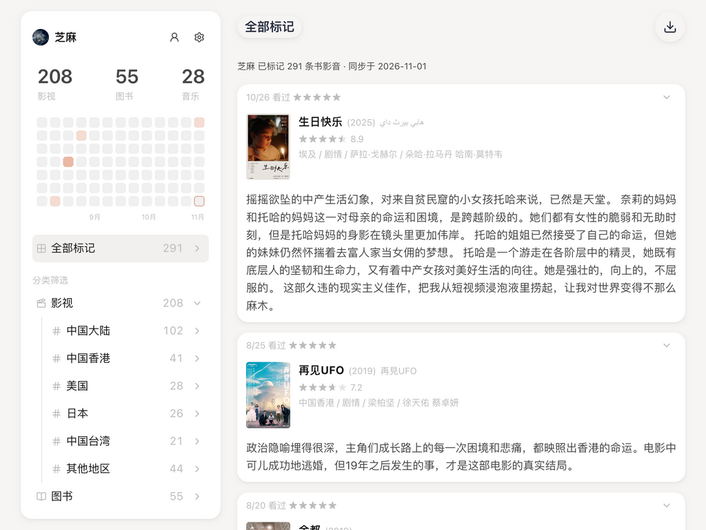

# 微墨·豆瓣

**把看过的电影、读过的书、听过的音乐，留在自己的电脑里。**

微墨·豆瓣是一款书影音备份与浏览 App。输入豆瓣 ID，就能把公开的标记、评分和短评整理到一起，重温当时的感受，找回喜欢的作品，也为年度回顾留下一份自己的记录。无需提供豆瓣密码。

[下载桌面 App](https://gitee.com/jiaowenjun/weimo-douban/releases) · [体验网页版](https://weimo.ink/douban/) · [GitHub 备用下载](https://github.com/jiaowenjun/weimo-douban/releases/latest)

<picture>
  <source media="(prefers-color-scheme: dark)" srcset="frontend/web/src/site/pages/assets/marks-overview-dark.png">
  
</picture>

## 留住记录，也重新发现收藏

- **备份自己的书影音经历**：把看过、读过、听过的作品，以及评分、标记日期和短评保存在本地。
- **找回值得重温的作品**：从五星收藏开始，或沿着类型、地区、年代等分类慢慢翻阅。
- **回顾最近的生活**：看看自己读了多少书、看了多少影视作品，在活动热力图里找回那段密集阅读或观影的日子。
- **整理一份自己的清单**：导出 CSV，用 Excel 或其他表格工具继续整理，制作年终榜单，或保留一份独立备份。

## App 有哪些亮点

| 功能 | 你可以怎样使用 |
|---|---|
| 书影音集中浏览 | 在一条时间线里回看全部记录，也可以分别浏览影视、图书和音乐 |
| 分类与评分筛选 | 按类型、国家／地区、年代、出版社或音乐流派等分类浏览，快速查看自己打过不同星级的作品 |
| 评分与短评同屏 | 同时看到自己的星级、豆瓣评分和当时写下的短评，保留个人感受与作品信息 |
| 简洁的阅读界面 | 亮暗主题、封面卡片、可折叠的作品详情；向下滚动即可继续浏览 |
| 本地保存 | 桌面 App 把同步后的记录保存在你的电脑上，已有记录可离线浏览；新数据和未缓存封面需要联网获取 |
| 后台运行 | 关闭窗口后仍留在菜单栏或系统托盘，正在进行的同步可以继续；完全退出 App 后停止同步 |
| 导出与更新 | 一键导出标记 CSV；支持检查新版本和确认安装更新，提供国内下载与更新渠道 |

## 三步开始

1. **下载安装**：从下载页选择与你的电脑匹配的安装包。
2. **填写豆瓣 ID**：打开 App，点击「开始备份」，输入 ID 并点击「验证 ID」，确认头像和昵称。
3. **开始浏览**：确认后开始同步，页面会逐步显示已获取的记录。同步完成后，可以分类浏览、筛选评分，或点击右上角的导出按钮保存 CSV。

豆瓣 ID 可以从个人主页地址中找到：例如 `douban.com/people/你的ID/` 中的「你的ID」。它可能是数字，也可能是你设置的英文名称。

| 平台 | 安装包 |
|---|---|
| macOS · Apple 芯片（M 系列） | 下载 `.dmg`，打开后将 App 拖入「应用程序」 |
| Windows · 64 位 | 下载 `.exe`，按安装向导完成安装 |
| 先体验，或使用其他设备 | 打开[网页版](https://weimo.ink/douban/)体验浏览；本地保存和 MCP 属于桌面 App 的能力 |

## 让 AI 帮你回顾书影音 · MCP

> 随 v0.5.2 起提供，旧版本安装包不含此功能。

连接支持 MCP 的 AI 助手后，你可以直接围绕自己的书影音记录提问，不用先导出文件、复制表格，再解释每一列是什么意思。

例如：

- 「我今年看过并打了五星的电影有哪些？附上当时的短评。」
- 「找出我读过的村上春树作品，按标记时间列出来。」
- 「我收藏的电影里，哪些导演出现得最多？」
- 「根据我的评分和短评，帮我写一份年度书影音回顾。」

助手可以查询标记、作品详情、评分分布和分类统计，也可以按关键词、日期、作品年份等条件查找。**MCP 只读取已有记录，不会修改你的评分、短评，也不会替你操作豆瓣账号。** App 退出后仍可查询最后一次同步的数据。

使用时，先在支持 MCP 的桌面版本中完成备份，再按[AI 助手连接指南](mcp/README.md#生成连接配置)添加连接配置。查询结果会交给你选择的 AI 助手处理，是否使用云端模型取决于该助手的设置。

如果助手反复提示「参数缺失」或查询失败，可参考[AI 查询问题排查](mcp/troubleshooting.md)，先确认调用参数，再判断问题出在助手、连接还是本地数据。

## 关于数据和使用

**免登录，读取公开记录。** 只需填写豆瓣 ID，无需提供账号密码。当前界面主要展示「看过／读过／听过」的公开记录。

**同步数量可能与豆瓣不同。** 私密、已删除或仅登录可见的内容可能无法获取。首次同步也需要一些时间；如果作品详情或封面尚未显示，可以稍后再看。

**桌面版的数据保存在本机。** App 可使用在线服务加快作品详情获取，该服务会收到作品编号和请求 IP，不接收你的评分、短评或豆瓣密码；你可以在设置中关闭「使用中心详情缓存」。网页版由在线服务提供，与桌面版分别保存数据。

**保留你在豆瓣的原始记录。** 微墨·豆瓣用于读取、备份和浏览，不会修改豆瓣上的评分或短评。

## 反馈与更多

遇到问题或有功能建议，欢迎[提交反馈](https://github.com/jiaowenjun/weimo-douban/issues)。描述使用平台和遇到的现象，会更方便排查。

[查看版本更新](https://github.com/jiaowenjun/weimo-douban/releases) · [AI 助手连接指南](mcp/README.md) · [开发与自行部署](docs/development.md)
